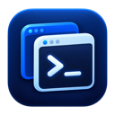
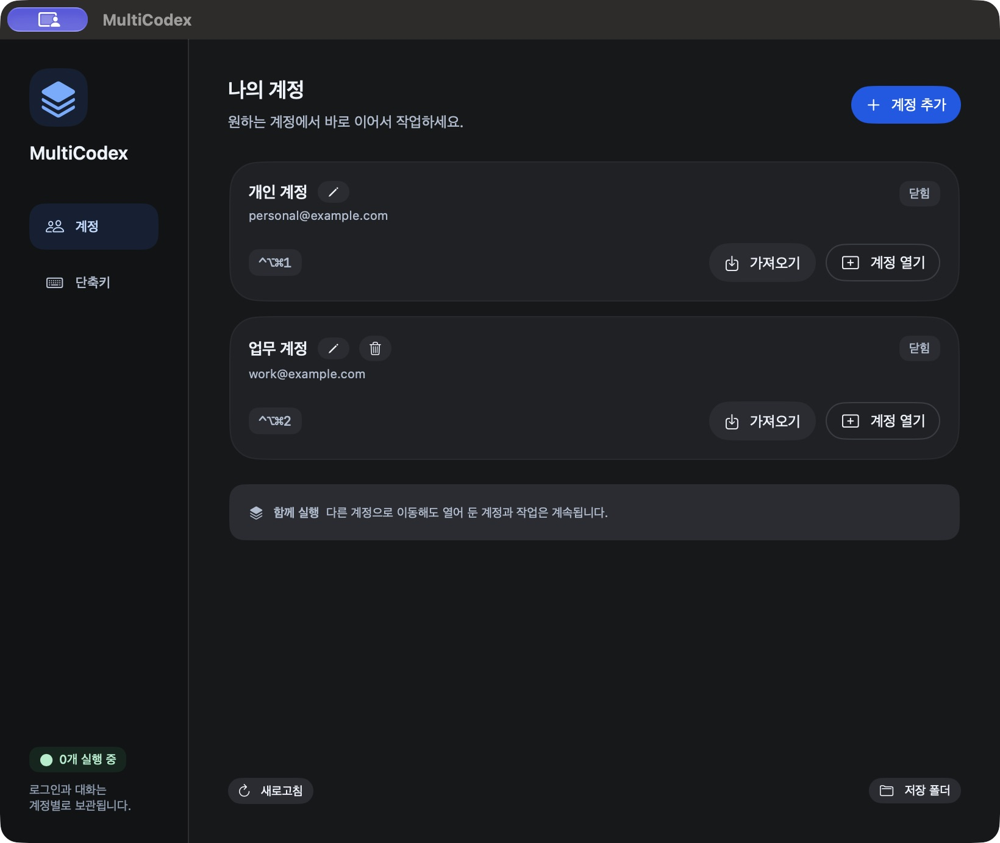
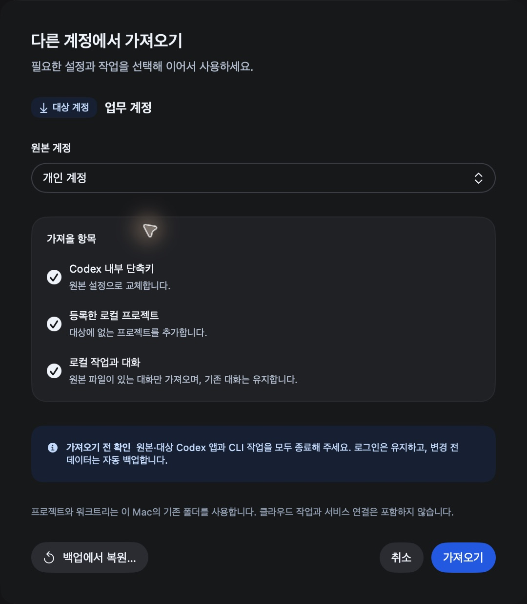

<p align="center">
  
</p>

# MultiCodex

**여러 Codex 계정을 한 Mac에서, 작업을 이어 가며 사용하세요.**

Codex 데스크톱 앱의 여러 계정을 나란히 실행하는 macOS 메뉴바 앱입니다. 로그인·설정·대화를 계정별로 보관하며, 다른 계정으로 이동해도 열어 둔 작업은 계속됩니다.

[다운로드](https://github.com/hogumachu/MultiCodex/releases) · [빠른 시작](#사용) · [계정 데이터 가져오기](#계정-데이터-가져오기)



*화면의 계정 이름과 이메일은 촬영용 예시 데이터입니다.*

## 주요 기능

| 기능 | 할 수 있는 일 |
| --- | --- |
| 여러 계정 함께 실행 | 계정마다 별도의 Codex 창을 열어 작업을 계속합니다. |
| 로그인·데이터 분리 | 계정별 로그인·설정·대화를 각각 보관합니다. 기존 Codex 계정도 그대로 사용합니다. |
| 빠른 계정 전환 | 메뉴바, **창으로 이동**, 사용자 지정 전역 단축키로 원하는 계정을 엽니다. |
| 계정 데이터 가져오기 | 다른 계정의 **Codex 내부 단축키·로컬 프로젝트·로컬 작업과 대화** 중 필요한 항목을 선택해 가져옵니다. |
| 가져오기 백업·복원 | 변경 전 데이터를 자동 백업하고, 완료 후 되돌리거나 백업 폴더에서 복원합니다. |
| 계정 목록 관리 | 이름을 바꾸거나 추가한 계정을 목록에서 삭제합니다. 목록에서 삭제해도 데이터 파일은 유지됩니다. |

## 설치

[GitHub Releases](https://github.com/hogumachu/MultiCodex/releases)에서 **MultiCodex-0.3.1-macOS.zip**을 내려받아 압축을 풀고 **MultiCodex.app**을 응용 프로그램 폴더로 옮겨 실행합니다. macOS 15 이상과 호환되는 Codex 데스크톱 앱이 필요하며, Xcode는 필요하지 않습니다.

v0.3.1은 **Developer ID 서명과 Apple 공증**을 완료했으며, Apple Silicon과 Intel Mac을 지원합니다.

## 사용

1. **계정 추가**에서 이름을 입력하고 **계정 열기**를 누릅니다.
2. 처음 한 번 해당 계정으로 로그인합니다.
3. 다음부터 메뉴바, **창으로 이동**, 또는 계정 단축키로 전환합니다.

계정 목록에는 제목과 연결된 이메일이 표시됩니다. 제목 옆 편집 버튼으로 이름을 바꿀 수 있으며 로그인·대화·단축키는 유지됩니다. MultiCodex를 종료해도 실행 중인 Codex 앱은 계속 열려 있습니다.

추가한 계정은 제목 옆 휴지통 버튼으로 목록에서 삭제할 수 있습니다. 확인 후 계정 목록과 단축키 설정만 제거하며, 로그인·설정·대화 파일과 실행 중인 Codex 창은 유지됩니다. 기존 Codex 계정은 삭제 대상에서 제외됩니다.

## 계정 데이터 가져오기

Codex가 압축 보관한 이전 채팅(`.jsonl.zst`)도 가져올 수 있습니다. 가져온 채팅은 대상 계정에서 이어서 진행합니다.

대상 계정의 **가져오기**에서 원본 계정과 필요한 항목을 선택합니다.



- **Codex 내부 단축키**: 원본 설정으로 교체합니다. MultiCodex의 계정 전환 단축키와는 별개입니다.
- **로컬 프로젝트**: 대상에 없는 프로젝트를 추가합니다.
- **로컬 작업과 대화**: 일반·보관 대화와 기록을 가져옵니다. 같은 ID의 기존 대화는 유지합니다.

실행 전 **원본·대상 Codex 앱과 해당 계정의 CLI 작업을 모두 종료**하세요. 원본 데이터와 대상 로그인은 유지됩니다. 프로젝트·워크트리·기존 첨부 파일은 같은 Mac의 기존 경로를 사용하므로 원본 폴더를 삭제하지 마세요. 클라우드 작업, 서비스 연결, 메모리와 자동화는 가져오지 않습니다.

변경 전 데이터는 자동 백업하며, 실패하면 자동으로 원복합니다. **가져오기 되돌리기** 또는 **백업에서 복원…**으로 수동 복원할 수도 있습니다. 복원하면 백업 이후 대상 데이터의 변경은 사라질 수 있습니다. 강제 종료로 중단된 경우에는 백업을 복원한 후 다시 실행하세요.

두 계정은 같은 Codex 버전으로 한 번씩 열고 종료한 뒤 가져오는 것을 권장합니다. 원본 파일이 없는 대화는 제외되며 완료 화면에 제외 건수가 표시됩니다.

## 단축키

첫 9개 계정의 기본값은 **⌃⌥⌘1–9**입니다. **단축키** 화면에서 원하는 키 조합으로 변경하거나 **사용 안 함**·**기본값**을 선택할 수 있습니다. 접근성·입력 모니터링 권한은 필요하지 않습니다.

## 저장 위치

`~/Library/Application Support/MultiCodex`에 다음 파일을 보관합니다.

- `profiles.json`: 계정 제목과 저장 경로
- `shortcuts.json`: 계정별 단축키
- `profiles/<UUID>/`: 추가 계정의 인증·설정·대화와 앱 데이터

기존 계정은 원래 저장 위치를 그대로 사용합니다. MultiCodex는 인증 파일을 교체하지 않고 계정별 경로로 Codex를 실행합니다. Codex 내부 옵션을 사용하므로 Codex 업데이트에 따라 호환성 확인이 필요할 수 있습니다.

## 개발

macOS 15 이상과 Swift 6을 지원하는 Xcode가 필요합니다. `MultiCodex.xcodeproj`의 **MultiCodex** 스킴에서 ⌘R로 실행하거나 ⌘U로 테스트합니다.

```sh
xcodebuild -project MultiCodex.xcodeproj -scheme MultiCodex -configuration Release -derivedDataPath build build
xcodebuild -project MultiCodex.xcodeproj -scheme MultiCodex -destination 'platform=macOS' -derivedDataPath build test
```

개발 시 `--data-dir <경로>` 실행 인자로 별도의 계정 목록을 사용할 수 있습니다.
